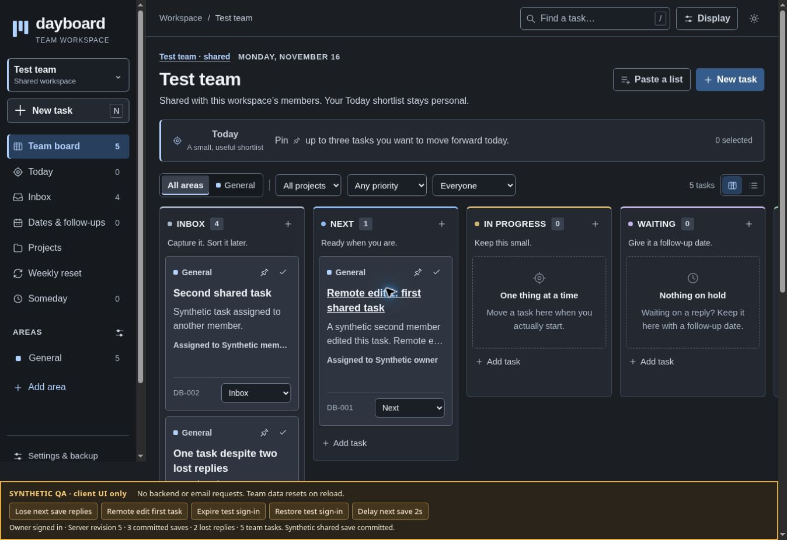

# Synthetic browser QA for Dayboard

This manual QA fixture bundles the current production app, shared store, model, and team UI with an in-memory synthetic SDK transport. The generated page visibly identifies itself as **synthetic client/UI QA** and uses `connect-src 'none'`. No backend requests or emails are made.

The fixture is separate from the production build. Only `qa/dist/` receives an enabled synthetic configuration; production source and deployment configuration are not changed. Generated output is ignored by Git.

This does **not** verify backend authorization, row-level security, actual two-browser concurrency, email delivery, or hosted service behavior. Those require the real database tests and a separate staging check. The fake transport deliberately implements only the client flows described below.

## Build and serve locally

Use Node 22 or newer. From the repository root, install the app's dependencies if needed, then build and serve the fixture:

```sh
cd apps/dayboard
npm ci --include=dev --ignore-scripts
node qa/build.mjs
python3 -m http.server 4174 --bind 127.0.0.1 --directory qa/dist
```

Open `http://127.0.0.1:4174/` in a direct browser tab. Use a dedicated local port/origin, separate from any real Dayboard data. After a production fix, rerun `node qa/build.mjs` and reload the QA page. The generated `qa-build-info.json` records the production source hashes that were bundled.

The app starts on Personal as usual. Open **Workspaces → Test team** to enter the synthetic shared board. The account is the synthetic verified owner `owner@example.test`, with one synthetic member. The board starts with two tasks and one General Area.

The synthetic team server and sign-in live only in memory and reset on page reload. Personal work uses the production app's ordinary browser storage on the local QA origin. The fixture itself never reads, resets, or seeds the personal-board storage key. When multiple preview paths share one origin, they also share that origin's personal browser storage.

## Visible QA controls

The labelled strip also appears inside open dialogs, allowing checks while an editor is open. Its controls remain operable during deliberately stalled saves.

- **Lose next save replies:** Arms the next commit. The synthetic server commits it once, then loses both replies for that request ID, including the client's automatic retry. The strip reports committed-save and lost-reply counts.
- **Remote edit first task:** Changes the first task's title and notes, advances its record version, and publishes a synthetic update notification.
- **Expire test sign-in:** Emits a sign-out event for the synthetic account.
- **Restore test sign-in:** Restores the same synthetic owner. This sends no email.
- **Delay next save 2s:** Commits the next save, then delays its response by two seconds. It can be combined with expiry or lost replies.

## Focused browser checks

| Check | Steps | Expected result |
| --- | --- | --- |
| Stale editor | Open the first shared task, type a draft, use **Remote edit first task**, then save. | The draft remains visible; the app detects that the record changed instead of overwriting the remote edit. |
| Uncertain save | Arm **Lose next save replies**, create a task, and save. | One server transaction and one new task are recorded; the app reports an unconfirmed save and keeps the draft. |
| Original-save recovery | After the uncertain-save error, type an additional edit, then use **Retry original save**. | The original receipt is recovered without another transaction or duplicate task. The additional typing remains available to save separately. |
| Sign-in expiry | Type an unsaved shared draft, use **Expire test sign-in**, then **Restore test sign-in** and the app's **Restore draft** action. | The app first returns to Personal. The draft is restored only for its original identity and workspace. |
| Quick-capture overlap | Arm **Delay next save 2s**, submit an Inbox quick capture, and type the next thought while the reply is delayed. | Confirmation of the first save retains the next thought. Submitting that thought creates a separate task. |
| Personal isolation | Create synthetic personal tasks and Areas, switch to Test team and make changes, then return to Personal. | The same personal tasks and Areas remain, without team records being merged into them. |

Supported transport operations are workspace list/snapshot/commit, receipt replay, minimal update subscriptions, and an empty pending-invitation list. Workspace creation and invitation mutations return an explicit QA-unsupported error.

## Observed browser result

The following image shows the synthetic candidate after the conflict, lost-response, same-account restoration, and delayed capture checks on November 16, 2026. The bottom strip identifies the test transport and reports its committed-save counts; this is not a live hosted team.


