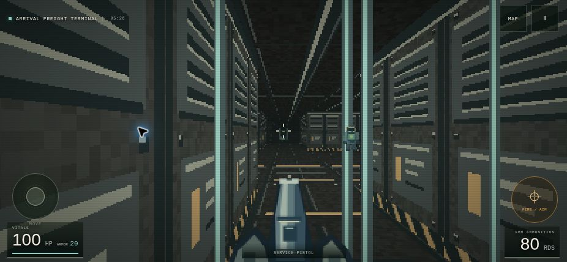

# BREACH 0.5.0 — Read the facility

This update focuses on solo discovery, combat variety, and phone controls. It
keeps all four existing missions and their geometry. Combat difficulty remains
independent of how much guidance the interface provides.

## Environmental discovery

Tools and obstacles share visual rules in both the WebGL and Canvas renderers:

| Equipment or system | Environmental cue |
| --- | --- |
| Industrial cutter | Welded crossbraces, bright weld points, cutter-shaped hardware; cut edges remain after opening |
| Conduit insulator | Coils and electrical arcs; an interrupted protection circuit becomes complete when equipped |
| Phase module | A shared ring motif and a shifting surface; a stable frame remains after passage opens |
| Access key | A physical card-reader socket |
| Relay links | Two traces meeting at a lock, with distinct lit states |
| Facility power | Plug and circuit markings with visible readiness states |

Return shortcuts use the same barrier material as their required equipment.
Natural names and facility signage remain; prerequisite instructions are no
longer baked into door textures. Reduced motion still displays attack telegraphs
but freezes decorative barrier animation.

### Guidance choices

- **Simple** retains the tutorial, direct objectives, route guidance, explicit
  requirements, and a brief explanation when a neutral sentry is first visible.
- **Moderate** gives short sensory observations such as welded braces or arcing
  current. It omits exact missing-tool instructions and the route to follow.
- **Expert** relies on the environment until an action is available. Blocked
  prompts, requirement popups, next-objective directions, objective map markers,
  and unacquired equipment names are hidden. Successful actions still provide
  brief confirmation, and acquired equipment remains visible.

The choice can change during a run under **Settings → Guidance**. The same
presentation rules cover briefings, HUD text, toasts, map inspection, and
accessible action labels. They do not change access requirements or combat.

## Encounter progression

Blacksite retains its original cast. Dead Relay introduces a north-gallery
security sentry in actor slot `n2`; it fights nearby infestation actors `n1`
and `n3`. Underworks adds a sentry in the old quarters (`q4`). A player can watch,
help security by shooting the creatures, or provoke security with an actual hit.
Firing nearby alone does not provoke it. There is no dialogue or formal alliance
system: taking a side is expressed through combat choices.

Unprovoked security does not block refuge use or mission completion. Aim
assistance skips neutral actors; automatic firing also refuses a shot when a
neutral actor occupies the firing line or shotgun spread. Manual fire remains
available. Faction kills do not count as player kills, and the results screen
does not imply that sparing a sentry leaves the mission incomplete. Distant
faction encounters wait until the player is nearby instead of resolving unseen.

Late Underworks actors `r4` and `ar3` are **phase stalkers**. They mark a landing
point for 0.8 seconds before blinking. A hit during this warning interrupts the
blink. The destination must still be clear of walls, closed gates, living actors,
and players, and must have the relevant lines of sight. A cooldown and arrival
grace period prevent immediate unavoidable damage.

The **reactor guardian** alternates two fixed-aim patterns:

1. A one-second charge warning, followed by a collision-aware rush along the
   marked lane. Sidestepping works; the rush can hit only once.
2. A 1.1-second volley warning, followed by three spreading projectiles.

Each attack is followed by a 1.65-second recovery window. The reactor shutters
visibly open; hits deal 1.6× damage during recovery and 0.65× against closed armor.
Spitters and sentries also strafe in firing lanes and retreat under close pressure.

## Phone controls

**Settings → Thumb controls** offers Compact, Standard, and Large. Compact is the
default for coarse-pointer devices whose shorter viewport dimension is at most
600 CSS pixels. A saved selection takes precedence and survives rotation.

Compact movement/fire sizes are 100/84 CSS pixels in portrait and 84/76 in short
landscape. Action targets retain a 44-pixel minimum. Joystick travel is calculated
from the live pad geometry, preserving full movement speed at every size. Dragging
the fire pad still turns the view while firing. Desktop controls are unchanged.

## Runtime contract and saves

Enemy IDs, counts, map geometry, progression gates, and save format version remain
stable. Existing saves load missing encounter fields with safe defaults. A cleared
actor remains cleared; start a fresh mission to experience an encounter already
finished in an older save. Hostility and active windups survive saving and restore.

`enemy.telegraph` carries `{kind,x,z,fromX,fromZ,radius,duration,remaining,targetId,targetKind}`.
Player and enemy IDs use separate target kinds so similarly named actors cannot
redirect a marked shot or charge after a target change.
Kinds are `blink`, `charge`, `volley`, and `shot`. Guardian phases are `stalk`,
`charge-windup`, `charge`, `volley-windup`, and `recover`.

World effects include `blink`, `beam`, and `charge-trail`. Events include
`provoked`, `enemy-warning`, `enemy-shot`, `teleport`, `boss-phase`, `enemy-hit`,
and `enemy-kill`. Warning events occur once per windup. Encounter events include
coordinates where applicable so optional procedural audio can attenuate distant
sources. Visual cues work with audio disabled.

Release labels in the site, server health response, and connection status are
kept in sync at 0.5.0. No room transport or multiplayer feature work is included. The shared simulation
and renderer retain their existing co-op contracts; real two-device/network
playtesting remains separate.

## Verification and remaining playtesting

Automated checks cover neutral provocation, faction damage attribution, the authored
Dead Relay skirmish, blink collision and interruption, boss dodge/recovery behavior,
legacy saves, invalid save rejection, guidance disclosure, automatic-fire collateral
protection, joystick travel, both renderer paths, and static export integrity.
Existing mission progression and shared co-op simulation tests are retained.

Browser checks cover actual gameplay movement and airlock interaction, continued
saved runs, Expert prompt visibility, the Compact layout at 428×926 and 926×428,
and staged views of the environmental/encounter artwork. The available browser
uses the Canvas fallback; WebGL state and geometry are checked by automated tests.
Physical iPhone touch feel, audio balance, and a complete expedition still need
hands-on playtesting. New maze topology and real stairs/elevation are not part
of this update.
