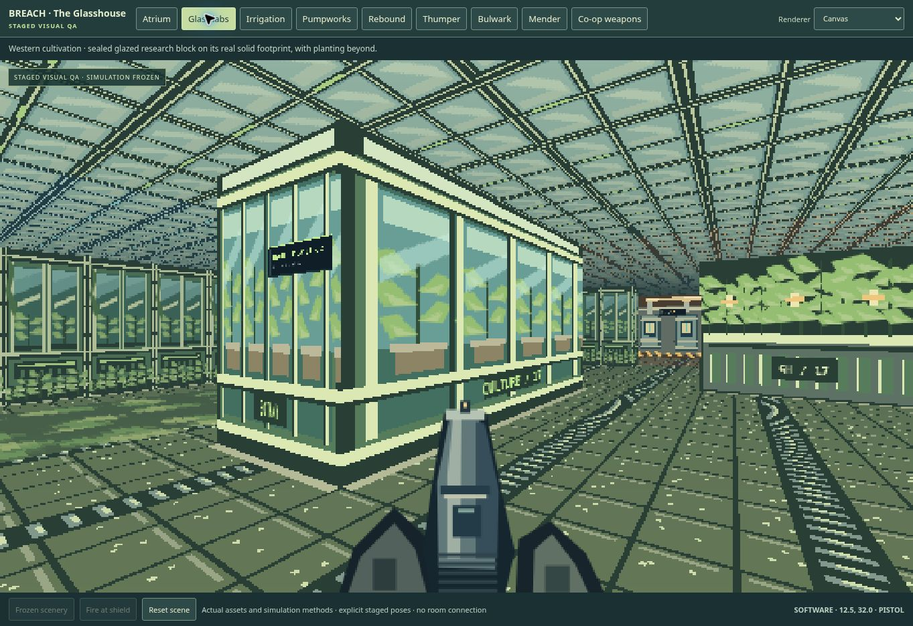

# BREACH 0.7 — The Glasshouse

The sixth operation adds an overgrown conservatory, two weapons and two enemy
types. The entire map is available solo or in a private two-player room. Existing
operations retain their authored geometry and progression.

## Explore the conservatory

The Glasshouse (`glasshouse-17`, level `glasshouse-17-v1`) has a 53×55 grid,
1,342 walkable cells and 23 enemies. Its safe arrival laboratory connects to a
ballistics practice bay, where the Rebound carbine can be collected before combat.
Restoring power in the planted atrium unlocks both cultivation wings and the
Thumper rack. Either wing can lead to either relay through the north gallery.

The western route passes planted beds, glass laboratory structures and pumpworks.
The eastern route passes water vats and a reversible cultivation shutter. Each
side of that shutter has a control; it cannot close over an operator, living
enemy or active grenade. Both relays open the propagation chamber. Defeating its
guardian releases the key, which opens a central return route to the arrival lift.
Two refuge stations support exploration and team revival after nearby threats
are cleared. The research wing also contains a staged security/infestation fight:
security remains neutral to the players until provoked.

There is no required split-up or simultaneous switch puzzle. One player can
complete every route and objective, while two can cover separate approaches.
Elevation and stairs remain outside this release.

## Two new weapons

| Weapon | Role and behavior | Limits |
| --- | --- | --- |
| Rebound carbine | Fires a visible slug path that may bank once off a wall. A reflected hit uses its final direction, allowing a well-placed bank shot to reach behind a Bulwark's shield. | 38 base damage, 0.52-second cooldown, 26-unit total range, finite slugs. A closed door absorbs the shot; there is no second aim-assist correction after a bank. |
| Thumper | Launches a visible bouncing grenade with a fuse and an expanding warning envelope. Its blast damages nearby enemies with distance falloff and respects solid cover. | 90 maximum base damage, 1.15-second cooldown, 1.5-second fuse, 2.8-unit blast radius, finite grenades. Splash can hurt the shooter, but never their teammate. |

Both weapons require deliberate firing even when automatic fire is enabled.
The original pistol, scattergun and Arc caster remain available; an optional
eastern detour in the Glasshouse supplies the Arc caster. The bottom inventory
and desktop keys 1–5 select the exact owned weapon, including in co-op. Cycling
with the existing desktop controls is still supported.

## Two new enemy tactics

**Bulwarks** turn with a directional shield. Hits inside the front cone receive
reduced damage and a visible shield impact; side and rear hits avoid that shield.
A close-range bash has a windup with a committed direction. Dodging it leaves a
1.4-second exposed window. The Arc caster can also force an opening. The rendered
shield cone and bash marker use the same direction and extent as the simulation.

**Menders** choose a wounded, living infestation ally in sight and visibly charge
a heal. Damaging the Mender interrupts that charge. A dotted windup line becomes
a solid healing beam only when health actually transfers; a broken cross marks
an interruption. Menders cannot heal themselves, security, guardians or dead
actors, and they do not resurrect enemies. Their own ranged attack still makes
them a threat when no ally needs healing.

The early route introduces the equipment and enemy roles before the mixed
encounters. The final chamber combines the existing guardian's attack/recovery
cycle with a Bulwark and a Mender; the Mender cannot repair the guardian.

## Scenery and readable combat



The image is a frozen scene inspection using the production renderer and assets.

The existing pixel-art style now includes planted beds, glass laboratories,
large root masses, water vats, pump machinery and a skylit canopy. Cyan arrival
spaces, green cultivation areas, amber pumpworks and violet research spaces help
identify routes. Solid scenery uses actual wall footprints, so visible cover
also stops movement and shots. Shallow garden and water textures are clipped to
walkable floor and do not imply additional collision.

Both WebGL and Canvas render the new guns, enemies, ricochet paths, grenade fuses,
blast radius, shield states and healing feedback. Teammates show their selected
gun; a remote shot does not recoil the local first-person weapon. New sounds
distinguish the carbine, grenade launcher, bank impact, explosion, shield opening,
healing and interruption. World sounds retain distance attenuation.

Water movement follows the reduced-motion setting. Rendering resolution and
effects remain bounded, and the new map's textures are allocated only when used.
Structural renderer tests check both paths; they do not measure physical-phone
GPU frame rate or battery use.

## Co-op and saves

Weapon racks grant ownership and starter ammunition to both operatives once.
Loose ammunition goes to the collector. Each player keeps an independent gun
selection and ammunition supply. Delayed grenades retain their owner for damage,
kill attribution and self-splash, even while another player is being simulated.
Live projectiles and effects are included in authoritative network snapshots.

Protocol 2 gains an additive `supportedMissions` list and an optional exact
`weapon` ID. Older clients can still use Crosslink and The Underworks, but cannot
attach to a Glasshouse room until refreshed. The client also refuses unknown
mission geometry before creating a view. See the
[co-op protocol](breach-coop-protocol.md) for the message contract.

Solo saves preserve active grenades, their remaining fuse and bounce state;
restoring does not refund ammunition or restart the fuse. Actual serialized
0.6.1 saves and power checkpoints from all five old missions are retained as
regression fixtures, along with geometry hashes. Acquired and spent Arc equipment
also survives a checkpoint restore. Co-op continues to use its separate live
room state without overwriting the solo save slot.

## Phone controls

SWAP remains removed. With four or five carried guns, the central bottom selector
wraps on portrait phones and stays in one row when landscape width allows. Every
gun remains directly tappable with a target at least 44×44 pixels. On narrow
portrait screens, USE aligns above FIRE to keep it away from the movement pad.
The existing Compact, Standard and Large presets and Safe/Classic fire choices
remain available. Safe mode still treats an immediate drag from FIRE as camera
movement and a stationary tap as a deliberate shot on release.

## Validation

Local validation passed 180 focused JavaScript checks and all three Python export
checks. The actual Canvas scene and phone HUD were inspected in the cloud browser,
including all five guns at 428×926, 926×428 and a 320×568 screen with Large controls.
Networked browser and published-service checks run in the release workflows.

The 0.7.1 follow-up preserves a quick co-op fire tap when its press and release
packets arrive before the same server tick. That pulse is consumed once, expires
after 300 ms, and clears on pause, restart or reconnection. A real room simulation
regression verifies one round is fired rather than silently dropping the tap.

Run the focused simulation, room, client, renderer and export suites with:

```sh
npm run test:breach
python -m unittest discover -s tests -p test_breach_export.py
```

The Glasshouse suite checks both relay orders, both wing approaches, a live
guardian and extraction; ordinary enemies are disabled in those route-isolation
checks. A separate safe-introduction traversal leaves all 23 enemies alive.
Combat checks cover shield direction, bank-shot range and door absorption, a
dodgeable bash, healing exclusions/interruption, grenade bounce/fuse/cover,
self-splash and teammate immunity, stable p2 kill attribution, shared weapon racks,
collector ammunition, checkpoints and legacy saves.

`scripts/breach-glasshouse-browser.mjs` is a CI browser check with a real browser
host and a normal WebSocket teammate. It walks the actual early route, acquires
both new guns, selects and fires each player's weapons independently, checks
mobile inventory bounds, and verifies replacement of the host transport on
reconnect while retaining progress. It observes authoritative state for timing
without injecting positions, equipment or progression. Existing networking and
Switchyard touch browser checks remain part of the same workflow.

Browser layout and staged visual inspection use the cloud browser's Canvas
fallback. Physical iPhone touch latency, sustained GPU performance and complete
two-person encounter pacing still require device playtesting.
