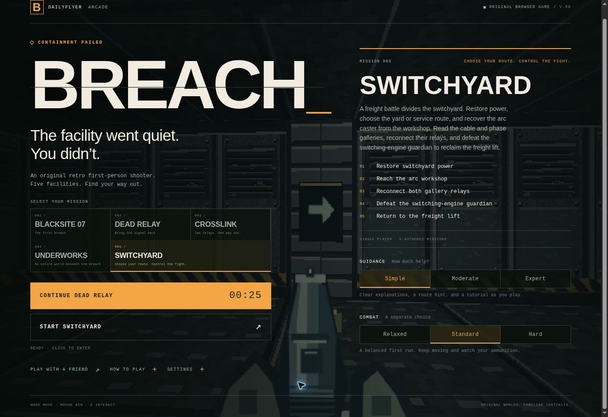

# BREACH 0.6.0 — Switchyard and deliberate touch controls

This release adds a fifth solo mission, a third weapon, reversible security
shutters, and a default phone gesture that distinguishes aiming from firing.
The existing four missions keep their geometry and continue to load older saves.

## Switchyard

Select **005 / Switchyard** on the main menu. The authored 45×49 grid contains
906 walkable cells, eight named areas, and 13 enemies. A first-run duration of
10–15 minutes is a design target, not a measured playtest result.

The freight-lift landing leads to an observation concourse. After restoring
power, either open the freight-yard shutter or follow the transformer service
loop around the fight. Both routes reach the arc workshop. Its cutter opens a
return grille, and its refuge provides a checkpoint and supplies.

The cable-gallery maze and phase galleries contain two relays that can be
completed in either order. One stalker appears before the mixed stalker/spitter
encounter. The switching-engine guardian occupies an arena with two cover banks
and circulation space. Its key opens the original freight lift for extraction.

Recognizable landmarks include a stalled freight car, transformer bank, and
security cabin. Their artwork matches solid map footprints. Numbered circuits,
routed floor cables, and matching shutter/switch markings connect an action to
its environmental result. Destination plaques identify the freight lift and
workshop return without requiring transparent walls or a new elevation system.

### Choosing how to approach the fight

The security/infestation group remains dormant until a player can actually see
one of its members nearby. Distance through a wall does not start the battle.
The shutter opening gives an observation position before entering the yard.

Security remains neutral until damaged by the player. Helping it against the
creatures does not provoke it. The player can engage, wait, close the shutter,
or use the service bypass. The yard contains an exposed supply cache. Waiting
does not grant invulnerability: surviving hostile creatures can still pursue
or shoot the player through an open route. There is no dialogue or reputation
system.

### Reversible shutters

Each shutter has controls on both sides and a permanent bypass. Raised shutters
can be lowered again. Living players and enemies overlapping the closing space
block the action; it never crushes or relocates an actor. Corpses do not obstruct
the mechanism. Closed shutters block movement, sight, bullets, and plasma.

Simple guidance explains the controls, Moderate offers sensory hints, and
Expert displays available actions while hiding blocked prerequisites. Controls
are offset from the passage centerline so their artwork does not obscure the
view through the raised shutter.

## Arc caster

The workshop introduces a short-range electrical weapon. It trades sustained
damage for a brief interruption of an ordinary enemy's movement and attacks.
It uses one cell per shot, hits one target, and does not chain into neutral
security. Deliberately hitting a sentry still provokes it. Guardians take damage
but resist the stun, retaining their attack patterns and recovery openings.

| Property | Value |
| --- | ---: |
| Range and aim-assist range | 7.5 world units |
| Base damage | 28 |
| Shot cooldown | 0.82 seconds |
| Ordinary-enemy stun | 0.65 seconds |
| Workshop weapon pickup | 12 cells |
| Refuge replenishment when owned | At least 4 cells |

Cell pickups provide additional ammunition. The pistol's emergency recharge does
not refill the caster. Original procedural weapon art, a cyan discharge, an
electrical sound, and a visible stun cue communicate the weapon's behavior in
both rendering paths. A guardian never shows the ordinary-enemy stun cue.

Desktop keys **1 / 2 / 3** select owned weapons. **Q**, the mouse wheel, and
**SWAP** cycle among them. Owned-weapon buttons also allow direct selection.
The Arc caster is currently found in Switchyard; the two existing co-op missions
and their weapon protocol remain unchanged.

## Phone aiming and firing

Under **Settings → Aim & fire**, **Safe · separate aim** is the default for
new preferences and for existing preferences without an explicit fire-control
choice. **Classic · fire + drag** remains available. Thumb size is a separate,
persisted Compact/Standard/Large choice.

| Touch gesture in Safe mode | Result |
| --- | --- |
| Drag the world | Look only |
| Start a look drag, then cross Fire | Continue looking without firing |
| Start on Fire and immediately drag | Look only for the remainder of that touch |
| Tap Fire without dragging | One shot on release, subject to weapon cooldown |
| Hold Fire still briefly | Continuous fire; dragging afterward tracks while firing |
| Cancel, lose capture, pause, switch settings, or rotate | Clear pending and active touch firing |

The classifier uses 8 CSS pixels of pre-arm travel and a 200 ms stationary hold.
Once a gesture becomes look-only, pausing that thumb does not turn it back into
fire. The button has distinct pending, firing, and aiming feedback. The lower
right rectangular Fire control leaves the main look surface clear; Compact is
64×52 CSS pixels, with larger selectable presets and at least 44-pixel action
targets. Left-thumb movement and right-thumb looking remain independent.

Automatic firing remains optional and defaults off. If enabled, it is suppressed
while a look gesture or pending Fire gesture is active. Desktop mouse aiming and
firing retain their immediate behavior.

## Implementation and compatibility

- `switchyard.mjs` exports `SWITCHYARD`; its mission ID is `switchyard-15` and
  level ID is `switchyard-15-v1`.
- Shared `WEAPONS` metadata supplies the simulation and presentation with ranges,
  assist ranges, cooldowns, and ammunition keys. Arc state is `player.hasArc`,
  `player.ammo.cells`, and `player.weapon === 'arc'`.
- `selectWeapon(id)` chooses an owned weapon; `switchWeapon()` cycles owned
  weapons. Existing cycle calls retain their meaning.
- Ordinary enemies use `stunTimer`; authored faction groups use `encounterId`
  and saved `encounterAwake`. Old saves safely default missing new fields.
- `kind: 'shutter'` doors carry `controlledBy`, `circuitId`, and `mark`.
  Repeatable `type: 'shutter-switch'` interactables carry `doorIds` and matching
  circuit metadata. `door.open` remains the collision authority. Both controls'
  `used` flags track the actual linked doors and can return to false.
- Shutter events use `{type:'shutter',id,open,x,z}`; arc effects carry origin and
  target coordinates. Both WebGL and Canvas update reopened and reclosed states.
- The solo save format remains version 1. New-field ownership, ranges, door
  occupancy, and linked-control consistency are validated. Checkpoint behavior
  preserves reversible shutter state without treating it as one-time progress.

## Verification

The Switchyard simulation tests traverse both approaches and both relay orders,
use real movement/interactions, fight the live guardian, return through the
grille, and extract. Unrelated enemies are disabled in those route tests;
separate tests cover faction behavior, observation staging, arc combat, resource
limits, interruption, shutter occupancy, projectiles, and malformed saves.

The phone gesture tests use the same state machine as the DOM handlers. The
browser regression script uses actual touch input against a local export,
checks ammunition and saved orientation, and verifies release/rotation stop
firing before a pause can clear inputs. It also covers simultaneous movement
and aiming, portrait/landscape layout, and save restoration.

Rendering tests cover both paths, including shutter open/close cycles, authored
landmark collision, floor cable routes, new weapon assets, and truthful stun
feedback. Independent review restored actual 0.5 saves and checkpoints from all
four earlier missions. Existing network regressions and export checks remain
release gates.

Cloud browser visual checks use Canvas because WebGL is unavailable there.
Physical iPhone touch feel, sustained device performance, audio balance, and
the mission's first-run duration still require hands-on playtesting. Stairs and
traversable elevation remain outside this update.

### Published release evidence

The gameplay release is commit `509ece8ec471ddf70abb78d6eeef0a6909592699`.
The [regression workflow](https://github.com/shnider42/daily_flyer/actions/runs/41001659312)
passed all 168 Node tests, three Python export tests, five existing browser
connection/layout checks, and ten new Switchyard/touch browser checks.
The [published sandbox smoke check](https://github.com/shnider42/daily_flyer/actions/runs/41001659297)
confirmed version 0.6.0 and byte-for-byte agreement between the deployed
gameplay assets and this release. Existing private-room replacement and
progress-retention checks also passed.

The live menu was inspected with Switchyard selected, and the settings showed
Safe aiming as the default for the existing browser's preferences.

