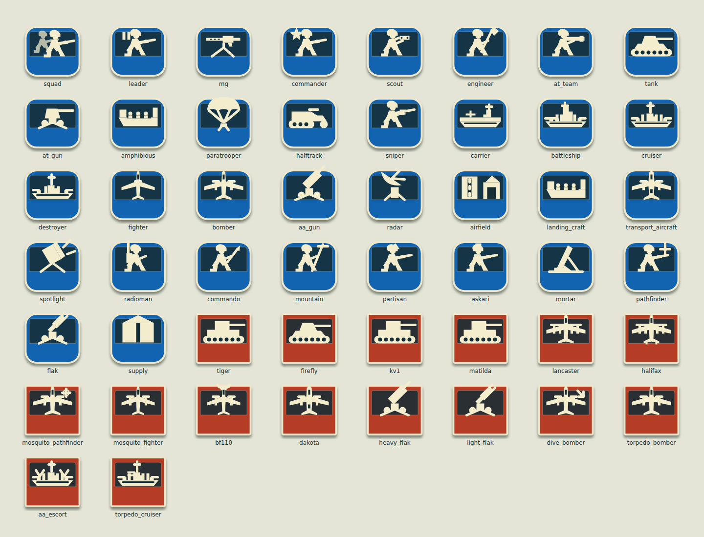
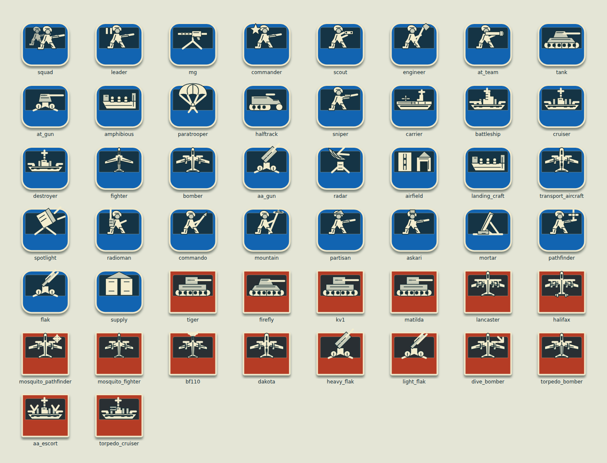
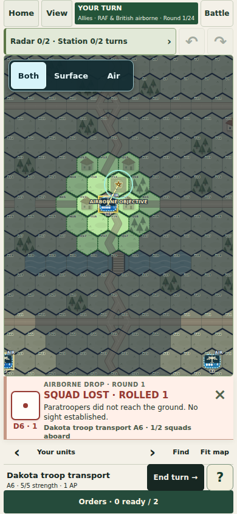
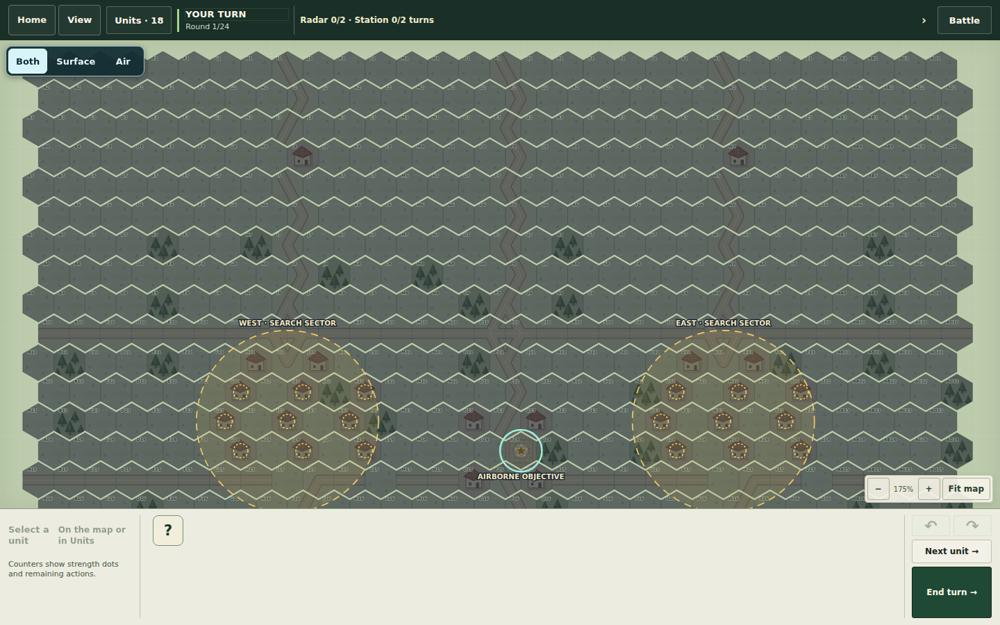

# Air combat and night-map changes prepared for review

Implemented on `feat/ww2-tactics`: consistent unit art, clearer dice results,
air-combat effects and a separate night operation with concealed deployments.

## Desktop selection and flight trails

Nightfall and other joint operations drew flight-preview polylines without the
styling previously limited to Battle of Britain. Explicit `fill="none"` and
shared flight-trail styling remove the black fill/wedge. Only aircraft create
flight previews; they show known AA coverage without disclosing readiness.

Selection and movement keep their existing two clicks: select a unit, click a
legal destination. Simple desktop now shows a concise flight/move cost hint and
a stronger destination hover. Threat confirmations and ambiguous shared-hex
pickers remain; routine movement does not gain another confirmation step.

## One unit-art family, two detail levels

**Units: basic** and **Units: detailed** use the same ivory/navy SVG family for
all 34 roles and 16 equipment variants. Basic uses recognizable silhouettes;
detailed adds structural seams, cutouts and secondary shading. Map counters and
close-ups use the same setting. Existing Classic/Illustrated preferences migrate
to Basic/Detailed. Faction/platoon colors, strength, AP and status badges remain.





## Dice and combat results

A persistent result strip stays on the playing surface in Simple, Moderate and
Expert. It shows a large d6, its numeric value, the outcome, and its consequences.
It can be dismissed and remains available in Battle reports. It reserves space
instead of covering the map, including narrow phones and landscape layouts.

A natural-one drop now clearly reads **SQUAD LOST · ROLLED 1**. Other reports
distinguish successful arrival, scatter, no safe landing, and loss on approach.
They show arrival AP, rough/water hazards and remaining cargo for the assigned
friendly Dakota. Reports do not reveal hidden batteries or cargo belonging to
the other army. The older short-lived airborne toast is suppressed when the new
strip is available.



Bombing now shows a released bomb followed by an impact flash/ring on a hit or
dust on a miss. Anti-aircraft fire shows tracers, muzzle flashes and airburst
puffs; fighters use aircraft tracers. Movable bombers, fixed Flak/AA, shipboard AA
and carrier strikes use the appropriate visual events. Effects use the resolved
server result, never another roll, and do not block orders. Reduced motion uses
static cues. Hidden firing origins are removed from live and replay events.

## Nightfall Veil

Choose **Current → Nightfall Veil**. It is a
separate 30×26 night operation; Nightfall Beacon retains its fixed layout.

Veil uses Beacon's forces, stats, bomb/flare capacities, finite field stores,
drop dice, two-platoon co-op, airborne objective and 24-round deadline. Each new
battle assigns one radar site to one of nine possible buildings in each of two
search sectors. German fighters, Flak, Spotlights and garrisons also receive new
private deployments within role-specific zones. Allied starts remain fixed.

The map marks **search areas**, not actual radar hexes. Fly a reconnaissance pass
or illuminate suspected buildings before ordering bombing against a spotted
target. This version retains the existing target/dice system; it does not add
blind area-bombing rules or a manual pre-battle phase.

Placement constraints keep heavy Flak behind forward searchlights, garrisons at
least four hexes from the airborne station, and every initial occupant in its
own legal slot. Every sector has the same count of possible radar sites and the
same role-zone shapes. Forces do not receive random extra strength or ammunition.
The computer searches using published possible sites and observed contacts.
Loading a save preserves the actual deployment instead of rerolling it.



## Validation

All **521 Python rule/API tests pass**, including the Legacy fingerprints.
The six focused browser harnesses listed below pass. Relevant air/effects/naval
rule checks also pass after the final combat-label adjustment.

Three older browser harnesses stop at pre-existing assertions reproduced on
unchanged `40bef58`: desktop expects a missing heading `<em>`; Dad mode expects
76px order cards where the layout gives 72px; learning expects a larger map at
320px width. Those unrelated assertions were not weakened in the tracked tests.

Focused rule tests check deployment variation, forty legal concealed starting
layouts, fixed rosters/resources, AI information limits, flare detection, drop
dice/ownership and save restoration. Effects tests check resolved hit/miss
events without extra rolls and hidden-origin redaction in live and replay views.

Browser checks cover all icon roles/variants at both detail levels, prominent
real drop outcomes, four phone sizes, both desktop layouts, animations and
reduced motion, Veil discovery/reconnaissance/save restoration, and four-player
Nightfall Beacon/Crosswind co-op regressions. JavaScript syntax and diff checks
pass. Human playtesting is still needed to
judge Veil's difficulty; constrained setup is not a claim of proven win-rate balance.

```sh
python -m unittest discover -s tests -p 'test_ww2*.py'
node tests/ww2-unit-art-browser.cjs
node tests/ww2-result-feedback-browser.cjs
node tests/ww2-effects-browser.cjs
node tests/ww2-nightveil-browser.cjs
node tests/ww2-nightfall-browser.cjs
node tests/ww2-crosswind-browser.cjs
```

Browser harnesses use disposable local databases. Forced rolls used to inspect
specific outcomes are confined to the test server; production dice are unchanged.
The unrelated pre-existing photo modification is outside this change.
