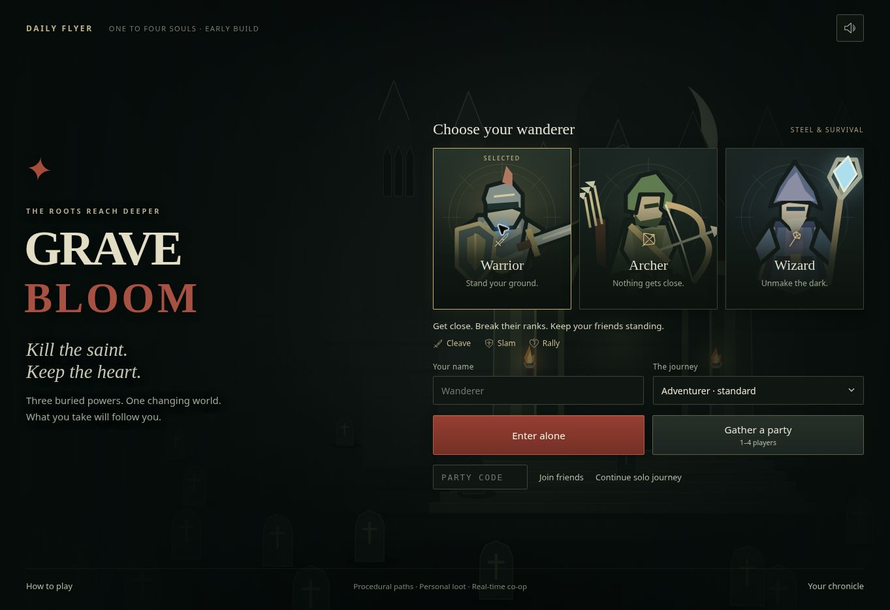

# GRAVEBLOOM



A standalone Daily Flyer cooperative action RPG. One to four players explore three connected, seeded dungeon areas, defeat their bosses, roll equipment, and decide whether to claim or cleanse the bosses' living hearts.

This is the first playable descent, not a long-form campaign or a persistent online character service. It has original procedural Canvas 2D art and synthesized sound effects; there are no external art or audio downloads.

## Play

Choose Warrior, Archer or Wizard. **Enter alone** starts a browser-local game. **Gather a party** creates a private six-character room code; friends choose a class and enter the code or follow the invite link. The host starts the party, and friends can join a journey already in progress. Four player slots are supported.

| Class | Primary | First ability | Second ability |
| --- | --- | --- | --- |
| Warrior | Cleave | Earthbreaker: stun and draw in nearby foes | Rally: shield and heal nearby allies |
| Archer | Quickshot | Splinter Volley: five piercing arrows | Venom Snare: poison an area |
| Wizard | Emberbolt | Winter Pulse: freeze nearby foes | Chain Lightning: jumps between enemies |

Fire on poisoned targets causes an eruption. Lightning on frozen targets shatters them for additional damage. These combinations work between players as well as within a single character's equipment build.

### The descent

1. **The Weeping Wilds / Briarhart:** tree and grave ruins; a charging, slamming guardian.
2. **The Sunken Ossuary / The Bellkeeper:** drowned stone chambers; radial attacks and summoned enemies.
3. **The Hollow Cathedral / The Hollow King:** the final throne, attack phases and reinforcements.

Every area has connected corridors, optional treasure, healing shrines, normal enemies, elites and its boss. Layouts, enemy placement and item rolls use the run's seed. Boss attacks display ground warnings before they land. The second phase begins as a boss loses health.

After each boss, claim the heart for party-wide powers and increased corruption, or cleanse it for 20 maximum health and recovery. The Briar Heart adds poison and the Echo Heart adds chain effects. Corruption strengthens subsequent enemies, increases elite presence and improves loot rarity odds. The final crown choice changes the ending; powers do not carry into a new journey.

### Equipment and progression

- Shared experience and level gains; individual equipment and gold.
- Weapon, armor and charm slots. Four rarities: Worn, Enchanted, Rare and Legendary.
- Rolled names, stats and affixes: burning, poison, healing on damage and lightning chains.
- Ground drops are reserved for their recipient. Chests and bosses provide personal rewards to all connected players.
- Walk over your drops to collect them. Compare and equip them in the pack.
- Salvage spare gear for gold. An equipped weapon can be tempered three times. Each temper adds `3 + 2 × area number` damage and costs `45 + 15 × level + 25 × existing tempers` gold.
- The pack holds 30 unequipped items. Additional pickups convert to their gold value.
- Three difficulty choices: Wanderer (`story`), Adventurer (`normal`), Tormented (`hard`).

### Controls

| Action | Desktop | Touch |
| --- | --- | --- |
| Move | WASD / arrow keys | Left thumbstick |
| Aim / primary | Mouse / hold left button; J also attacks | Hold Attack; automatic nearest visible target |
| Abilities | Q / E, or K / L | Two buttons above Attack |
| Dodge | Space | Dodge button |
| Heal | R | Bottle button |
| Chest / shrine / revive | F; hold beside a downed teammate | Hand button; hold to revive |
| Equipment | I | Pack icon |
| Map | M | Map icon |
| Pause / options | Escape | Menu icon |

Dodge briefly prevents damage. Healing recharges after 18 seconds. A nearby teammate can revive a downed player by holding interact for 2.4 seconds. If every connected player falls, the journey ends.

Solo play pauses when a menu is open or the page loses focus. Online combat continues when menus are open. Guidance can be Simple, Moderate or Expert; Simple gives plain-language objectives and a boss marker.

## Saves, privacy and boundaries

Solo journeys, options and a small completion chronicle are stored in this browser's local storage. The full solo checkpoint includes inventory, combat state and random-number state; it can be resumed on the same browser. A fresh run replaces that checkpoint. Starting a new journey resets its level and equipment.

Multiplayer state is authoritative on one server and kept in memory. A reconnect credential in `sessionStorage` restores the same avatar and equipment after a brief interruption. Disconnected seats are reserved for 90 seconds. Leadership transfers to a connected teammate. Empty parties expire after 30 minutes. **A server restart or deployment ends active parties.** There are no accounts, chat, payments, email requests, analytics scripts, cross-device solo saves or persistent online characters in this version.

An invite link contains only the room code, never the reconnect credential. Display names and game actions are visible to that party. Anyone with a valid code can join an available seat, so a code is an invitation mechanism rather than an account-level access control system.

## Run locally

Requires Node 22 or newer.

```sh
npm ci --prefix games/gravebloom
npm test --prefix games/gravebloom
node games/gravebloom/server.mjs
```

The server binds `0.0.0.0` and reads `PORT` (default `3000`). Preview launchers can pass `--host` and `--port`. Static assets and WebSockets are served from the same origin. `GET /health` returns a bounded status summary.

## Architecture

`public/sim.mjs` is the shared deterministic, DOM-free authority. Solo play steps it locally. Multiplayer sends only bounded input intentions and named actions to the server; the server owns movement, hits, health, XP, inventory, choices and results. It steps at 30 Hz and broadcasts at 15 Hz. The browser interpolates visual entity positions between snapshots.

The first snapshot and every world transition include full geometry. Repeat snapshots contain dynamic state plus changed map objects (rooms, chests, shrines). The client can request a full resynchronization. Tokens and internal simulation state are never broadcast. Input sequences, payload sizes, connection counts, party counts, message rates, origin checks, static asset paths and socket backpressure are bounded. Inputs expire after 250 ms without refresh.

`public/renderer.mjs` caches terrain, culls objects outside the viewport and caps the canvas around 3 million pixels with DPR no greater than 1.5. Fog of war uses nearby party visibility. The interface is HTML/CSS above a full-screen canvas, with responsive portrait and landscape layouts and separate touch controls. A small Web Audio module creates effects only after a user gesture.

## Focused verification

`npm test` runs simulation and actual HTTP/WebSocket integration checks. Coverage includes connected layouts across multiple seeds; wall collision and normalized movement; class abilities and elemental combinations; loot, equipment and tempering; dodge and potion timing; revives and party wipe; three-area progression and boss attack sequences; complete solo checkpoint restoration; four-player bounds; authenticated reconnect and host migration; stale or malformed input; private credentials; compact world snapshots and full resynchronization; and static/origin boundaries.

The initial build was also exercised in a real browser for class selection, solo entry, movement, menus, and a two-player room with shared state. A physical iPhone/Safari performance pass remains outstanding.

## Render deployment

This game uses a dedicated `feat/gravebloom` branch in `shnider42/daily_flyer` and one Node web service, consistent with other standalone DFE games.

- Build: `npm ci --prefix games/gravebloom && npm test --prefix games/gravebloom`
- Start: `node games/gravebloom/server.mjs`
- Health path: `/health`
- Region: Virginia
- Compute plan: free
- Instances: one (room authority is held in process memory)

The Flask application and other DFE deployments are independent of this entry point.
