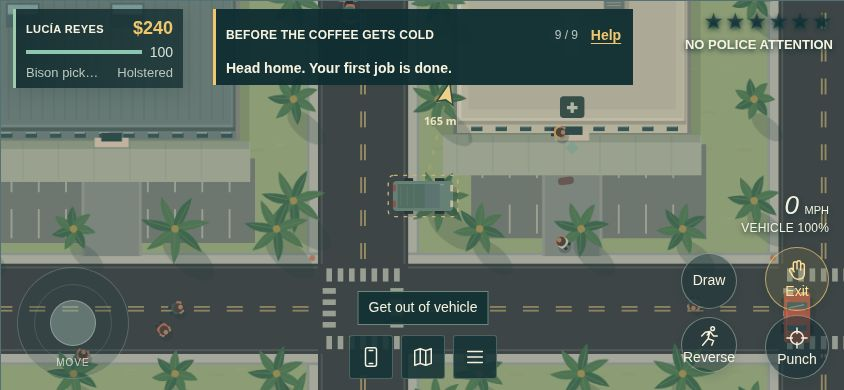

# SUNCOAST



An original Daily Flyer top-down city game. Play Lucía Reyes, a 32-year-old Cuban mechanic and recovery driver returning to Bahía Lucero, a fictional Miami-inspired coastal city.

This first playable version is a single-player story sandbox with three islands, eighteen authored missions, enterable buildings, vehicles, police attention, persistent choices, and recovery after arrest or injury. It uses original procedural Canvas 2D artwork and synthesized audio. There are no external assets, libraries, accounts, analytics scripts, or paid APIs.

## The city and story

Twelve main missions follow a neighborhood acquisition scheme through Santa Elena, Cayo Espejo and Puerto Umbral. Six optional missions follow Tomi’s repair business, Inés’s neighbors, and Voss’s driving/coastal work. Public exposure, a negotiated future, and private control offer three endings. Side stories never block main progress.

| Island | Character | Access |
| --- | --- | --- |
| Santa Elena | Cafés, neighborhood streets, repair shops, clinic, docks | Open from the start |
| Cayo Espejo | Hotel, Art Deco nightlife, marina, municipal records | Opens after **Open Water**, main mission four |
| Puerto Umbral | Container terminal, private estate, Suncoast headquarters | Opens after **Customs and Favors**, main mission eight |

The islands are physically connected. Reaching restricted land early, including arriving by water, triggers six stars. Leaving the restriction lets the ordinary pursuit/search rules take over. No invisible story wall prevents exploration.

### Your first job

**Before the Coffee Gets Cold** begins at Café Inés. Enter, speak to Inés, collect the clinic delivery, walk to Tomi’s garage, take a loaner, drive to the clinic, park, enter, deliver, choose whether to keep a fee, and go home. The tutorial teaches actions reused throughout the story. It does not force a crime or a kill.

### Optional personal stories

| Contact | First story | Follow-up |
| --- | --- | --- |
| Tomi | Not Scrap Yet | Parts Unknown |
| Inés | After Hours | Leave a Light On |
| Voss | Three Stops, No Excuses | Low Tide, High Price |

There are 110 authored steps and eighteen decisions with thirty-seven selectable outcomes across the main and optional missions. Choices affect cash, reputation, wanted levels, persistent flags, contact reactions, and the ending. The missions share a core progression path; choices do not generate an unlimited branching campaign. Every main story can be completed without a mandatory kill.

## Play

Use the gold objective marker and the short instruction panel. Open **Phone** to select a story job, find paid work, read contacts, or revisit decisions. Open **Map** to see the islands and set a personal waypoint. Gold business markers identify the sixteen named interiors; three additional shops can also be entered.

| Action | Desktop | Touch |
| --- | --- | --- |
| Walk / swim | WASD or arrow keys | Left stick |
| Drive | W/S accelerate and reverse; A/D steer | Point left stick in desired direction |
| Brake / reverse | Space brakes; S reverses | Hold Brake / Reverse to stop and back up |
| Interact / enter / exit | E | Gold Use button; label changes with context |
| Sprint | Shift | Run button |
| Aim / attack | Mouse + left button, or F | Hold Fire / Punch; assisted aim |
| Draw / holster | Q | Draw / Holster button |
| Phone | Tab | Phone button |
| Map | M | Map button |
| Pause | Escape | Pause button |

Stop a vehicle before getting out. Small cars, sedans, sports cars, pickups, vans, motorcycles, boats, and police vehicles have different speed, acceleration, turning and durability. Vehicles can be damaged or disabled. Tomi handles repairs, paint, and recovery.

Simple guidance explains actions in plain language. On phones, tap Help beside the objective to expand its full guidance. Moderate shortens hints; Expert retains objectives. Camera zoom, sound, optional quiet instrumental radio, touch controls and reduced interface motion are adjustable. Solo play pauses in menus, conversations, and when the page is hidden. Portrait and landscape layouts are supported.

## Police attention

Unwitnessed minor crimes do not automatically create a wanted level. Nearby civilians can report crimes after a short delay; patrols can witness them directly. Noise from gunfire is easier to notice. Officers pursue a visible player and otherwise search around the last known position. Building geometry blocks sight and projectiles.

| Stars | Response |
| --- | --- |
| 1–2 | Local patrols attempt arrest when close on foot |
| 3 | Armed response |
| 4 | Tactical units and police-car roadblocks |
| 5 | Helicopter support |
| 6 | Maximum response; restricted islands sustain it until you leave |

Break sight and stay hidden to reduce stars over time. A respray can help after sight is broken at lower wanted levels. It cannot erase a restricted-island violation or serious charges. Pause includes a surrender action while wanted.

Police movement is a lightweight, collision-aware pursuit model. It does not yet simulate full road-network dispatch or room-by-room interior raids. Entering while visibly pursued at three or more stars is blocked; lower-level indoor hiding takes time.

## Hospitalization and arrest

Hospitalization costs up to the greater of $40 or 8% of cash, capped by available cash. Lucía keeps her ammunition. Arrest costs up to the greater of $70 or 12% of cash, capped by available cash; it confiscates her pistol and ammunition and impounds the current vehicle.

Both outcomes preserve completed missions, choices, reputation and island access. Continue at the clinic/precinct, or restart the active job at its checkpoint. Previous decisions remain binding when a job is retried, and their rewards cannot be collected twice. Recovery fees cannot put the player into debt. Vehicle recovery is available at the garage or precinct.

Contacts acknowledge selected story decisions, hospital visits, arrests and the ending when Lucía returns.

## Work and reputation

Five repeatable activities supplement the authored stories:

| Activity | Start | Base reward |
| --- | --- | --- |
| Taxi fare | Café / garage | $100 |
| Courier delivery | Market / depot | $120 |
| Harbor delivery | Docks / marina | $160 |
| Three-checkpoint circuit, 110-second limit | Garage | $220 |
| Medical pickup and delivery | Clinic | $140 and one community reputation |

Visit a business and talk inside to accept work. Complete the active story job before taking a paid side job.

Community reputation of at least three reduces repair/respray prices by 30%; at least four reduces treatment to $15. Underworld reputation of at least three adds $30 to taxi, courier and harbor rewards. Truth reputation of at least four reduces arrest fines by 35%. These values are independent, so Lucía can build mixed relationships rather than being forced into a single alignment meter.

## Saves and privacy

The complete solo story is stored in this browser under `dfe.suncoast.save.v1`, with settings stored separately. Autosaving runs during play, on important transitions, and when pausing or leaving. Export and import JSON backups from Pause to move a story to another device. Starting a new story explicitly replaces the current local save.

There is no account, multiplayer service, chat, cloud save, tracking library, or backend player database. The hosting provider receives ordinary web requests. Browser storage can be cleared by the user or browser; export a backup for a separate copy.

## Mobile fixes in 0.1.1

A hidden minimap previously multiplied its existing backing size by device pixel ratio on each HUD update. On high-density landscape phones this could grow without bound, exhaust canvas memory, and break rendering. Hidden/zero-size canvases now skip allocation and drawing; resize calls are idempotent. The world and terrain cache now render at phone pixel density instead of enlarging undersized bitmaps.

Phone HUD controls have at least 44px targets, safe-area offsets, separated landscape positions, expandable objective help, and no full-screen backdrop blur. Menus and dialogue hide and disable gameplay controls. Rotation and visual viewport changes resize the renderer and clear held inputs. The mobile interior camera follows Lucía so room edges and doors cannot move her behind touch controls. The stick has a small dead zone and ignores a second pointer until the current one releases.

The touch Brake / Reverse control now stops forward movement, then backs up. Saved games resume with the occupied vehicle stationary. Existing story saves and decisions remain compatible.

Focused regressions cover repeated hidden-map drawing, 3× portrait/landscape buffers, allocation budgets, backing-store release, braking/reversing out of a wall, and safe vehicle resume. The development server exposes `/__qa/mobile` for narrow and landscape layout checks; this page is outside the production assets and does not emulate physical Safari or device pixel density.

## Development and deployment

No dependency installation is required. Node 22 or newer:

```sh
npm test --prefix games/suncoast
npm run dev --prefix games/suncoast
```

`server.mjs` is a local development server. Production consists only of `public/` and runs as a static site on Render.

- Source: `shnider42/daily_flyer`, branch `feat/suncoast`
- Render build: `node --test games/suncoast/tests/*.test.mjs`
- Publish directory: `games/suncoast/public`
- Game URL: `https://dfe-suncoast.onrender.com/`

The existing DFE Flask entry point and other deployed games are not changed by this new branch.

### Architecture

`world.mjs` owns city geometry, named places and vehicle definitions. `content.mjs` owns authored missions, contact text and endings. `sim.mjs` is a DOM-free simulation, stepped at 60 Hz with bounded catch-up. `renderer.mjs` uses culled, cached terrain chunks and uses native screen density up to 3× within a 4-million-pixel main-canvas budget. Maps stay within 2 million pixels; terrain rasterizes at camera density with a 48 MiB cache budget. `app.mjs` owns responsive UI, input and local persistence. `audio.mjs` creates original effects after a user gesture.

### Verification and current limits

Focused behavioral tests exercise every authored mission, island order and early entry, world collision, witnesses and search decay, death versus arrest, checkpoint choice/reward persistence, saves, boat deliveries, races, medical transport, services and impound access. Geometry checks verified that every named building is reachable and every enterable exit is clear.

A real Chromium browser pass exercised the opening, interiors, dialogue, driving/braking, a witnessed incident, police search decay, phone-sized layout, on-screen stick movement, and touch interaction. This is not a physical iPhone/Safari performance certification. Multiplayer, a large procedurally reactive population, advanced traffic navigation, and interior combat encounters are not implemented in this first release.
